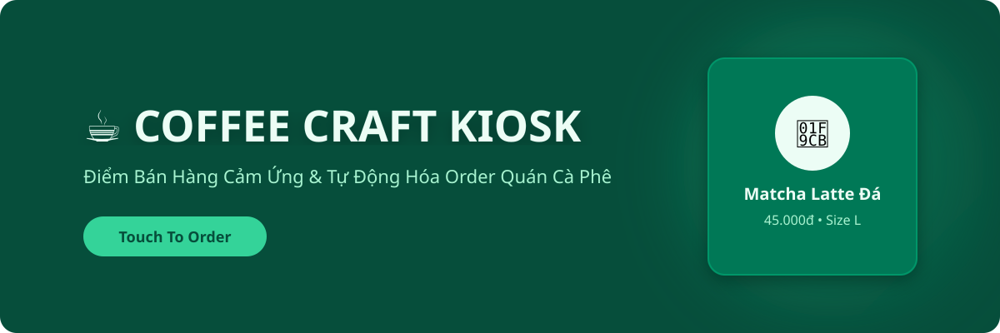

# ☕ Coffee Craft - Touch POS & Smart Order Kiosk Web

<p align="center">
  
</p>

Giao diện Kiosk Màn hình Cảm ứng & Điểm bán hàng POS Quán Cà phê với tùy biến đồ uống trực quan

Một dự án Web Application hoàn chỉnh được **lập trình từ đầu (build from scratch)** bao gồm cả Backend Web Server bằng Go và giao diện người dùng tương tác hiện đại (Responsive Web UI bằng HTML5 & Tailwind CSS).

---

## 🌟 Điểm Nổi Bật
* **Giao diện Trực quan:** Thiết kế chuẩn Retina với ảnh đồ họa vector SVG sắc nét.
* **Mã nguồn độc lập (Zero Config):** Khởi chạy server web và phục vụ toàn bộ giao diện chỉ với 1 câu lệnh Go.
* **Sẵn sàng mở rộng:** Kết nối API REST JSON mượt mà với cơ sở dữ liệu.

---

## 🚀 Hướng Dẫn Chạy & Trải Nghiệm Giao Diện

### 1. Chạy Unit Test
```bash
go test -v ./...
```

### 2. Khởi chạy Web Server
```bash
go run main.go
```

Sau khi chạy lệnh trên, hãy mở trình duyệt web và truy cập địa chỉ:  
👉 **http://localhost:8087**

---

## 📝 Bản Quyền & Tác Giả
Được xây dựng bởi [k3ndzy](https://github.com/k3ndzy). Phát hành theo giấy phép MIT.
